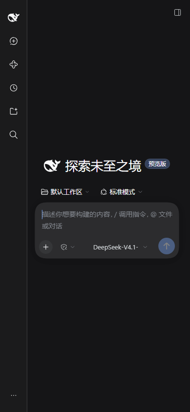

# dsh-remote

用手机控制**任意一台**跑着 [DeepSeek Harness](https://github.com/deepseek-ai/deepseek-harness) 的机器。
DSH 侧永远不开入站端口，不做 NAT 穿透、不打洞——两端都主动连出，在你自己的一台服务器上会合。



## 组成

| 部分 | 说明 |
|---|---|
| [`dsh-ssh-bridge/`](dsh-ssh-bridge/) | DSH 插件 + 中继服务端。两种传输：`relay`（HTTPS 单端口）和 `ssh`（remote forward） |
| [`android-app/`](android-app/) | Android WebView 壳。只内置中继地址和访问密钥，token 每次启动现取 |
| [`skills/`](skills/) | 两个给 agent 用的 skill：`dsh-remote` 装手机访问，`multi-agent-fleet` 管多机多 agent |
| [`tools/`](tools/) | 验证脚本：走一遍真实重定向链路、抓浏览器控制台、渲染图标预览 |

## 两个 skill

都是写给 **agent** 看的操作指南，不是给人读的教程。装一次，之后一句话就能让 agent 按流程干活。

| skill | 什么时候用 |
|---|---|
| [`dsh-remote`](skills/dsh-remote/SKILL.md) | 「帮我把手机访问配好」——装插件、起中继、配对、排障 |
| [`multi-agent-fleet`](skills/multi-agent-fleet/SKILL.md) | 「这几台机器上的 agent 你来管」——多机并行派活、资源护栏、质量门禁、定时巡检 |

`multi-agent-fleet` 提炼自一次约 28 小时的真实作业：一台 DSH 当协调者，把 coding agent 派到
5 台机器上并行修 39 个 issue，期间踩过的坑（全局 `pgrep` 卡死 18 小时、默认 codegen units 导致
OOM、`tmux kill-session` 不杀子进程、PR 开到了 fork 上）都写在里面了。

## 三种用法

**只想在电脑上用** —— 不需要这个项目。

**手机浏览器访问（推荐）** —— 部署中继，手机开一个网址：

```
DSH 机器 ──出站 TLS──▶ 你的服务器 :8443 ──HTTPS──▶ 手机浏览器
```

**复用现成 sshd** —— 服务器上什么都不用装，手机用任意 SSH 客户端：

```
DSH 机器 ──出站 SSH──▶ 你的服务器 :22 ──手机 -L──▶ 手机浏览器
```

## 快速开始（relay）

**1. 服务器上跑中继**

```bash
scp -r dsh-ssh-bridge user@server:/opt/
cd /opt/dsh-ssh-bridge
node bin/dsh-relay.mjs --port 8443 --host <你的公网地址> --pool 64
```

它会打印 host token、access key、证书指纹，以及一段可以直接粘贴的插件配置。

**2. 配置 DSH**

```yaml
- insert:
    - id: ssh-bridge
      name: dsh-ssh-bridge
      config:
        transport: relay
        relay:
          host: relay.example.com
          port: 8443
          token: 'REPLACE_WITH_YOUR_HOST_TOKEN'
          accessToken: 'REPLACE_WITH_YOUR_ACCESS_KEY'
          fingerprint: 'REPLACE_WITH_RELAY_CERT_SHA256'
          poolSize: 32
          refreshMs: 300

# 手机看到的不是回环地址，必须显式放行
- id: connection
  config:
    trustedHosts: !!js "[...(ctx.webStartup?.trustedHosts ?? []), 'relay.example.com:8443']"
```

**3. 手机配对**

桌面打开 `http://127.0.0.1:<dshPort>/ssh-bridge?rk=<accessToken>`，扫码或复制链接。
之后手机直接开 `https://relay.example.com:8443/`，Cookie 能留 30 天。

细节、配置表和排障在 [dsh-ssh-bridge/README.md](dsh-ssh-bridge/README.md)。

## 作为 DSH skill 安装

`skills/` 下每个目录是一个 skill。加进 `skill-filesystem` 的搜索路径即可：

```yaml
- id: skill-filesystem
  config:
    customSkillDirs:
      - /path/to/dsh-remote/skills
```

重启 DSH 后，`dsh-remote` 和 `multi-agent-fleet` 会出现在 skill 目录里，之后：

- 「帮我把手机访问配好」→ agent 按 `dsh-remote` 走
- 「这几台服务器上的 agent 你来调度」→ agent 按 `multi-agent-fleet` 走

skill 只在被加载时才占上下文，平时只是一个名字和一句话描述。

## 需要注意

- **不要提交真实凭据。** 访问密钥、host token、证书指纹、keystore、编译好的 APK 都不该进仓库。
  这个仓库里的都是占位符。
- **`poolSize` 必须大于浏览器的并发连接数**（默认 32，中继 `--pool` 64）。太小会让中继对部分
  资源回 `503`，页面表现是纯白屏、且没有任何报错——这是最容易误判成"前端 bug"的坑。
- 中继证书是自签的：App 把它作为额外信任锚打包，浏览器首次访问点一次「继续访问」。
  换证书要同时换 PEM 和指纹。

## 已验证

- **46 个测试**：主机密钥校验、两种传输的端到端、配对链接、认证拒绝、证书指纹固定、重连、
  连接池排空时的排队与恢复。
- **真实 Chromium**（390×844 手机视口）经公网中继加载：`#root` 挂载 34,766 字节，无未捕获异常，
  无失败请求。
- **真机**：Android 10+ 经中继连入，界面可用。

## License

MIT
